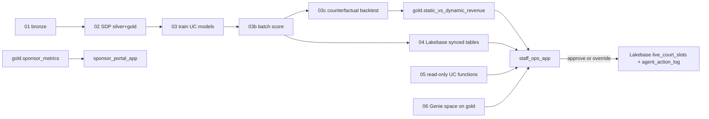

# Project Specification: B4L Fondation Smart Badminton Center (Databricks Demo)

## 1. Objective & Context

Build a working end-to-end demo on the **Databricks Data Intelligence Platform** for **B4L Fondation** ([b4l-fondation.ch](https://b4l-fondation.ch/)), the **16-court** badminton centre at Ch. du Viaduc 12, 1008 Prilly (Lausanne), Switzerland. The centre was fully renovated in summer 2025. It is open to everyone without membership, 7 days a week and on public holidays.

The demo must showcase:
1. **Dynamic Court Pricing.** Move from the static CHF 25 / 32 / 35 tiers to demand-based pricing between CHF 18 and CHF 42 across the 16 courts. Pass and prepaid holders must stay protected.
2. **Player Retention & Matchmaking.** Churn alerts, automated doubles partner matching, and backfilling late cancellations from the waitlist.
3. **Sponsor Media Kit & Analytics.** Anonymised footfall and corporate-lunch metrics for potential sponsors.

The centre books through **Xplor Deciplus** (online, app with centre code `badmintonlausanne`, and phone). API credentials are not connected yet, so the demo uses **realistic synthetic data** for the 16 courts over the **past 24 weeks (168 days) plus the next 14 days**, anchored to the run date.

### Facts vs. demo assumptions
- **Facts** are from b4l-fondation.ch (Accueil, Centre, Horaires/Tarifs, Réservation pages, retrieved Nov 2026).
- **Demo assumptions** are marked `[ASSUMPTION]`. They should be confirmed with B4L (Dominique, Direction) before any customer-facing use.

---

## 2. Target Repository Structure (Databricks Asset Bundles)

The whole demo deploys with `databricks bundle deploy`.

```text
b4l-databricks-demo/
├── databricks.yml                     # Bundle: vars catalog, schema_prefix; target dev (FEVM)
├── src/
│   ├── b4l/
│   │   ├── pricing_rules.py           # Single source of truth: hours, tiers, passes, guardrails
│   │   ├── calendar.py                # Closures, Vaud public + school holidays
│   │   ├── synth.py                   # Synthetic world: players, groups, passes, blocks, weather, demo moments
│   │   ├── demand.py                  # Deterministic demand simulator (shared by 01 and 03c)
│   │   ├── generator.py               # Assembles bronze tables, demo-moment checks, dirty rows
│   │   ├── schemas.py                 # Bronze/gold table contracts shared by all components
│   │   ├── validate.py                # Data quality rules + statistical checks (section 4.1)
│   │   ├── pipeline_helpers.py        # Grids, SQL snippets and DQ rules for the Lakeflow pipeline
│   │   └── genie_space.py             # Genie space definition (instructions, synonyms, sample SQL)
│   ├── 01_generate_synthetic_data.py  # Bronze tables
│   ├── 02_lakeflow_etl.py             # Lakeflow Spark Declarative Pipeline -> Silver + Gold
│   ├── 03_train_mlflow_models.py      # Fill probability, churn, cancellation models (UC registry)
│   ├── 03b_batch_score.py             # Writes scores + price recommendations to Gold
│   ├── 03c_counterfactual_backtest.py # Static vs dynamic replay -> gold.static_vs_dynamic_revenue
│   ├── 04_setup_lakebase.py           # Lakebase project, operational tables, synced tables, grants
│   ├── 05_agent_bricks_tools.py       # Read-only UC functions (agent tools)
│   └── 06_setup_genie.py              # Creates Genie space via API
├── apps/
│   ├── staff_ops_app/                 # App 1: Reception & Ops Cockpit (Streamlit)
│   └── sponsor_portal_app/            # App 2: Sponsor Media Kit preview (Streamlit)
├── tests/                             # pytest: rules, guardrails, generator distributions, k-anonymity, simulator, backtest
├── GENIE_SETUP.md
└── README.md
```

### Deployment target (decided)
- Workspace profile: `fevm-serverless-stable-yqq46w`.
- Catalog: `serverless_stable_yqq46w_catalog`, as bundle variable `catalog`. Creating a new catalog is not assumed to be possible on FEVM.
- Schemas: `b4l_bronze`, `b4l_silver`, `b4l_gold`, `b4l_models` (variable `schema_prefix`, default `b4l`).
- Compute: serverless jobs, pipelines and SQL warehouse.

---

## 3. Domain Rules (from b4l-fondation.ch)

All rules live in `src/b4l/pricing_rules.py` and `src/b4l/calendar.py`. The generator, the pipeline, the UC functions, the apps and the tests all import from there.

### 3.1 Facility
- **16 courts.** `[ASSUMPTION]` Named `Court_01`–`Court_16` and split into **Main Hall** (`Court_01`–`Court_08`) and **West Hall** (`Court_09`–`Court_16`). `Court_01`–`Court_04` are designated **Prime Show Courts** for sponsor naming rights. The website does not describe halls or show courts.
- Amenities useful for the sponsor story:
  - 4 changing rooms with showers
  - a bar with sandwiches and snacks
  - a shop (shoes, rackets, shuttles)
  - stringing and equipment rental
- Location: opposite Malley Lumière, between Tour Tilia and the Grand Casino.
  - Prilly-Malley station is 2–4 min walk (3 min by train from Lausanne).
  - Next to the **Vaudoise Aréna**.
  - About 600 public parking spaces within 300 m.
- The site states **1,368 bookable slots per week**. Use this to check the generated slot grid; small differences from the hours below are acceptable and should be documented.

### 3.2 Opening and rentable hours
| Day type | Centre open | Courts rentable | Last game |
|---|---|---|---|
| Mon–Fri | 08:00–23:00 | 08:00–22:00 | 21:00–22:00 |
| Sat, Sun, public holidays | 09:00–19:30 | 09:30–19:00 | 18:00–19:00 |

- **Closed:** 24, 25 and 31 December, and 1 January. **2 January counts as a public holiday** (weekend hours).
- Vaud public holidays use weekend hours.

### 3.3 Slot grid
- One booking = **1 court for 1 hour, for 2 or 4 players**. Bookings can run for several consecutive hours.
- `[ASSUMPTION]` Start times fall on a 30-minute grid (`:00` or `:30`), because the site refers to arrivals at 11:00, 13:00 and 09:30. Weekday starts run 08:00–21:00. Weekend and holiday starts run 09:30–18:00.
- The **tariff is set by the start time**. The site says an 11:00 arrival pays the day rate and a 13:00 arrival pays the lunch rate.
- Playing past the booked time is charged extra.

### 3.4 Base tariffs (per court per hour, for 2 or 4 players)
| Tier | Price | When (by start time) |
|---|---|---|
| Journée (Day) | CHF 25 | Mon–Fri 08:30–11:29 and 13:30–16:59 |
| Week-end | CHF 25 | Fri from 13:30, Sat/Sun and holidays all day |
| Famille (Family) | CHF 18 | Day and weekend times only; at least 1 adult + 1 child up to age 18 |
| Midi (Lunch) | CHF 32 | Mon–Fri 11:30–13:29 |
| Soir (Evening) | CHF 35 | Mon–Thu 17:00–21:00 starts (Friday afternoon and evening use the weekend rate) |

- `[ASSUMPTION]` A Mon–Fri 08:00 start pays the day rate. The day window officially starts at 08:30.
- Preferential rates also exist for **families, schools and foundations/associations**. `[ASSUMPTION]` These are modelled as a `rate_category` on bookings: `standard`, `family`, `school`, `association`. The site publishes no school or association price; the demo uses **CHF 20 per court-hour** for both `[ASSUMPTION]`.
- Courts are **paid on arrival at reception**. Players must check in at reception to confirm their court, which produces the `check_ins` data used for footfall.

### 3.5 Courses and court blocks
- **Bad'matin:** drop-in coached session, **Tuesday 09:30–11:00**. It is **CHF 30 per person**, including shuttles, racket and coach, with a loyalty card at **CHF 300 for 11 sessions**. It is **not held during Vaud school holidays**. `[ASSUMPTION]` It blocks `Court_01`–`Court_04`.
- **Private lessons:** CHF 50 per hour plus the court fee, booked by phone. Coaches are Alexeï and Pavel. Published availability:
  - Mon 15:30–16:30 (Pavel)
  - Tue 11:00–13:00 or 20:30–21:30
  - Wed 13:00–14:00 or 18:00–19:00
  - Fri 15:00–16:00
  - `[ASSUMPTION]` Lessons use `Court_16` and happen in about 65% of the published slots during term (40% in holidays).
- **Club BLA** (Badminton Lausanne Association) runs junior and adult courses at the centre. `[ASSUMPTION]` `Court_13`–`Court_16`, Monday 18:00–20:00 (term only, juniors) and Thursday 20:00–22:00 (adults, all year). The club keeps the court if a lesson collides.
- **School sessions** `[ASSUMPTION]`: a local school uses `Court_09`–`Court_10` on Tuesday and Thursday 13:30–15:30 during term, at the school rate.
- These blocks reduce public inventory. Store them in `court_blocks` and keep them out of dynamic pricing.

### 3.6 Passes and prepaid products
| Product | Mechanics | Facts |
|---|---|---|
| **Carte Prépayée** | Money balance; the court price is deducted on arrival | CHF 200 gives CHF 230 of credit (+15%); CHF 300 gives 360 (+20%); CHF 500 gives 650 (+30%) |
| **Pass Liberté** `[ASSUMPTION: the unlabeled hour pack on the tariffs page]` | Hour pack in *midi* or *soir* variant, deducted on arrival | 25 h: midi 675 / soir 750. 50 h: 1,250 / 1,400. 100 h: 2,300 / 2,600 (CHF 23–30 per hour) |
| **Pass Chrono** | Hour pack with an expiry date, non-refundable | 25 h: midi 500 / soir 575, valid 3 months. 50 h: 900 / 1,000, valid 6 months (CHF 18–23 per hour) |

How dynamic pricing treats them (`[ASSUMPTION]`, to confirm):
- **Pass Liberté and Pass Chrono holders are never re-priced.** A booking deducts one hour from the pass, whatever the dynamic price.
  - A *midi* pack is valid for day, weekend and lunch slots.
  - A *soir* pack is valid for all slots.
  - The agent may offer them an empty slot but must not charge extra.
- **Carte Prépayée** holders pay the dynamic price out of their balance. Their bonus credit still makes it cheaper than paying full price.
- Pass expiry (Chrono 3 or 6 months) is a retention trigger: remind players with unused hours before the expiry date.

### 3.7 Cancellation and waitlist
- Players must cancel **at least 24 h in advance, by phone**. Cancellation by email is not accepted.
- A late cancellation or no-show is **billed at full price, including for pass holders**.
- There is a waitlist: if nothing is free, reception puts the caller on a list. The demo turns this into the **waitlist backfill** use case. A predicted late cancellation triggers an offer to the next suitable waitlisted player.
- Phone booking hours: Mon–Fri 08:00–23:00, Sat/Sun 10:00–19:00.

### 3.8 Dynamic pricing guardrails (demo policy)
- Hard floor **CHF 18.0** (the Family rate) and hard ceiling **CHF 42.0**.
- `[ASSUMPTION]` A dynamic price may move at most ±40% from its base tier. It is **locked once the slot is booked**, and the price shown is logged at booking time.
- The Family, school and association rates, Bad'matin, private lessons and club blocks are **never re-priced**.
- Pass protection works as described in 3.6.
- Every proposed or applied price is logged with the rule that produced it.

---

## 4. Synthetic Data Specs (`01_generate_synthetic_data.py` → `b4l_bronze`)

| Table | Content |
|---|---|
| `courts` | 16 courts, hall zone, `is_show_court` |
| `players` | 3,000 players (about 20% join during the window): `player_id`, `full_name`, `email`, `phone`, `skill_tier` (Beginner/Intermediate/Advanced), `segment` (Corporate_Lunch, Evening_Regular, Family_Weekend, Student_OffPeak, Club_Member), `preferred_lang` (FR/EN) |
| `pass_wallets` | `player_id`, `product` (None/Carte_Prepayee/Pass_Liberte/Pass_Chrono), `variant` (midi/soir), `balance_chf` or `hours_left`, `purchased_at`, `expires_at` |
| `corporate_accounts` | `[ASSUMPTION]` Companies near Malley whose employees book lunch slots |
| `court_blocks` | Bad'matin, private lessons, club BLA and school sessions (`block_type`) |
| `bookings` | `booking_id`, `court_id`, `start_ts`, `duration_h`, `player_id`, `party_size` (2/4), `rate_category`, `tier`, `base_price_chf`, `price_shown_chf`, `price_paid_chf`, `payment_method` (on-site/prepaid/pass), `channel` (online/app/phone), `booked_at` (lead time) |
| `booking_participants` | `booking_id`, `player_id`. Everyone on the court (2 or 4), not just the booker. Used for doubles matching and per-person footfall |
| `booking_events` | create, cancel, no-show, check-in; with `hours_before_start` |
| `waitlist` | `player_id`, requested window, `created_at`, `resolved_booking_id` |
| `check_ins` | Arrivals at reception (persons), the basis for footfall |
| `weather_lausanne` | Daily rain and temperature |
| `calendar` | Closures, Vaud public holidays, Vaud school holidays, `[ASSUMPTION]` Vaudoise Aréna event days |

Generation rules:
- Generate only rentable hours and only on open days. Validate the total against the site's 1,368 slots per week.
- Calibration targets `[ASSUMPTION]`:
  - Mon–Thu evening occupancy above 85%
  - Lunch occupancy 60–75%
  - Weekday morning 30–45%
  - Weekends 70–90%
  - Rainy weekends +25%
  - School holidays: less family and corporate demand, more students
- **Price elasticity per segment** is built in, so the fill model learns how demand responds to price:
  - Corporate_Lunch: low elasticity
  - Student_OffPeak: high elasticity
  - Evening_Regular: medium elasticity
- **Slot substitution:** each player is either *flexible* (may move to a cheaper slot within about ±2 hours on the same day) or *fixed* (only plays at their usual time). This lets the backtest count cannibalisation, for example evening players moving to a cheaper lunch.
- **The demand logic lives in `src/b4l/demand.py`**, a deterministic simulator. With the same seed, players, weather and calendar, prices are the only input that changes. The generator calls it with the **published tariff**, so the 24 weeks of history are the "static world". 03c calls it again with dynamic prices.
- Late cancellations and no-shows are about 6–10%, higher for long lead times and for players without passes.
- Seeded demo moments, anchored to the run's `as_of_date` (job parameter, default today in Lausanne) and listed in `b4l_bronze.demo_moments`. The generator checks each one and fails the job if a moment is missing:
  1. A rainy Saturday spike: the first Saturday at least 2 days ahead, booking ahead of the usual dry-Saturday pace
  2. An under-used Tuesday lunch 1–3 days ahead (nearest weekday otherwise), behind its usual pace, where the price drops
  3. A drifting Evening_Regular (regular baseline, last 30 days down to 35% of it or less) who gets a voucher
  4. A predicted late cancellation filled from the waitlist
  5. A Pass Chrono with unused hours near its expiry date

### 4.1 Data quality and representativeness
The 24-week window (about early June to late November when anchored to November 2026) is chosen so the data shows real seasonal contrast.

**Seasonality and calendar:**
- Summer dip during the Vaud school holidays (July to mid-August): fewer evening regulars and corporate players, more students.
- Strong recovery at the *rentrée* (late August), and the autumn/winter indoor peak from October.
- Public holidays (1 August, Lundi du Jeûne fédéral) use weekend hours, and demand behaves like a weekend.
- The Vaud autumn school holidays shift demand from families towards daytime.
- Weather follows Lausanne monthly norms (rain frequency and temperature). Rain increases weekend demand and slightly reduces cancellations; heat reduces summer daytime demand.

**Realistic player behaviour:**
- **Activity is skewed:** about 20% of players make about 60% of bookings. Regulars keep a habitual weekday, time and partners; casual players book once or twice a month.
- **Player lifecycle:** new players join throughout the window, some ramp up, and a defined share (about 10–15%) drifts or churns gradually. This gives the churn model a real signal rather than a coin flip.
- **Stable doubles groups and partners** in `booking_participants`, so `find_doubles_partners` returns credible matches. Some groups hold a **weekly fixed slot** (for example Thursday 19:00), booked about 5 days ahead; this regularity also keeps the churn label from being driven by random noise.
- **Lead times by segment:** Corporate_Lunch books 1–3 days ahead, Evening_Regular a week ahead (recurring), Student_OffPeak on the same day.
- **Pass behaviour is consistent:** buying a Pass Chrono or Liberté shifts the player's booking pattern towards the slots the pass covers. Wallet balances and hours decrease with each booking.

**Internal consistency (hard rules, enforced by `src/b4l/validate.py` and pytest):**
- No court is double-booked. No booking overlaps a court block, a closure or non-rentable hours.
- The tier and `base_price_chf` always match `pricing_rules` for the start time. Static history has `price_paid_chf = price_shown_chf` = the tariff (or the special rate, or 0 for pass hours).
- Every check-in belongs to a non-cancelled booking. No-shows have no check-in. Late cancellations and no-shows are billed.
- Pass wallets never go negative, and Chrono hours are never used after expiry.
- Every resolved waitlist entry points to a booking created after a cancellation, for the same slot window.
- Participants per booking match `party_size`, and the booker is one of them.

**Statistical checks (validated each run, logged to a `b4l_bronze.data_quality_report` table):**
- The occupancy calibration targets above hold by tier, day type and month.
- The no-show and late-cancellation rate is 6–10%.
- The churn label base rate is 8–20% (the upper part when the last 30 days include the Christmas closure). **Churn rule:** a *regular* averages at least 2 plays per 30 days over days 31–120 before the snapshot (`avg_monthly_plays_baseline`); the label is true when plays in the last 30 days are at most 35% of that baseline. Comparing with a 90-day baseline instead of only the previous 30 days avoids flagging normal month-to-month noise.
- Fill rate varies with price within each tier (non-zero elasticity). Without this, the fill model has nothing to learn.
- No `sponsor_metrics` cell is suppressed by accident because of too little data. Monthly segments hold at least 10 people.

**Deliberate dirty data in bronze (about 1%)**, so the Lakeflow expectations have something to catch in the demo:
- Duplicate booking events
- Late-arriving events
- Malformed phone and email values
- A few bookings referencing an unknown court

Silver drops or quarantines these rows, and the expectation metrics show it.

**Volume:** about 1,370 slots per week × 24 weeks × 16 courts' occupancy gives roughly 20–25k bookings, about 60–80k participant rows, and check-ins to match. This is enough for model training and for Genie questions broken down by week, tier and segment.

---

## 5. Technical Architecture & Component Specs



A single bundle job, `b4l_demo_job`, runs the tasks in order: 01 → 02 → 03 → 03b → 03c → 04 → 05 → 06.

### A. Lakeflow Pipeline (`02_lakeflow_etl.py`, Spark Declarative Pipelines with expectations)
**Silver (`b4l_silver`):**
- Deduplicate bookings and apply the booking event history.
- Join weather and calendar data.
- Pseudonymise `player_uuid` with **HMAC-SHA256 keyed by a secret-scope key**, not a plain hash.
- Bronze PII is restricted with UC grants or column masks. Under the Swiss nLPD, pseudonymised data is still personal data.

**Gold (`b4l_gold`):**
- `court_utilization_hourly`: occupancy, revenue and average price, by court, hall, date, hour and tier.
- `player_features`: visits in the last 30 days vs. the prior 30 and vs. the 90-day baseline (`avg_monthly_plays_baseline`), preferred slots, pass state and expiry, top doubles partners, and the rule-based churn label (section 4.1).
- `daily_kpis`: revenue, occupancy, cancellations, waitlist and footfall per day, for Genie and the app.
- `slot_features`: features for each upcoming slot.
- `sponsor_metrics`: monthly anonymised footfall from check-ins, corporate-lunch players, family weekend traffic, show-court exposure. Any cell with fewer than 10 people is suppressed (k-anonymity).

The static vs. dynamic comparison is **not** built in the pipeline, because it depends on the trained model. See section 5.F.

### B. MLflow Models (`03` + `03b`, registered in `b4l_models` with a `champion` alias)
1. `fill_probability_model`: predicts the probability a slot fills, given its features **and a candidate price**.
2. `player_churn_model`: for regulars, the label is "plays in the next 30 days at most 35% of the baseline", the same rule as `churn_risk_rule` shifted forward. Training uses earlier snapshot dates; features come from before the label window to avoid leakage.
3. `cancellation_risk_model`: probability of a late cancellation or no-show (less than 24 h before start), which would otherwise be billed in full.

`03b_batch_score.py` writes:
- `gold.slot_price_recommendations`: tries prices from CHF 18 to 42, keeps the one with the highest expected revenue, then applies the guardrails.
- `gold.player_scores`
- `gold.booking_cancellation_risk`

There is no model serving endpoint in v1.

### C. Lakebase Operational State (`04_setup_lakebase.py`)
A Lakebase (Postgres) project with:
- `live_court_slots`: `(slot_id, court_id, hall_zone, slot_start, tier, base_price_chf, dynamic_price_chf, status, applied_rule, locked)`, seeded by a synced table from `gold.slot_price_recommendations`.
- `matchmaking_lobbies`: `(lobby_id, court_id, slot_start, skill_tier, spots_open, player_uuids)`.
- `agent_action_log`: `(action_id, ts, actor, action_type, details, status)`.

The app service principals get only the grants they need. Lakebase is the only operational store; there is no Delta fallback flag.

### D. Agent Tools & Genie
**Read-only Unity Catalog functions** (`05_agent_bricks_tools.py`). UC functions cannot write to tables, so they only compute.
- `apply_dynamic_price_with_guardrails(slot_id, proposed_price)` returns the final price, the rule applied and the reason. It enforces sections 3.6 and 3.8.
- `trigger_player_concierge(player_uuid, trigger_type)` returns a French/English message for one of:
  - a waitlist backfill
  - a doubles match
  - a pass expiry reminder
  - a retention voucher. `[ASSUMPTION]` A CHF 10 stringing voucher; B4L offers stringing in-house.
- `find_doubles_partners(player_uuid)` is a table function returning players with the same skill tier and time preferences.

**Writes** happen in `staff_ops_app` after staff approve: an update to Lakebase plus an `agent_action_log` row. Optionally, an Agent Bricks Supervisor combines the Genie space with these functions, and the app still performs the write.

**Genie** (`06_setup_genie.py` plus `GENIE_SETUP.md`):
- The space is created through the API on the gold tables.
- French/English synonyms go into table and column comments: *Tarif journée*, *Tarif midi*, *Tarif soir*, *Tarif week-end*, *Famille*, *Bad'matin*, *Taux d'occupation*, *Carte prépayée*, *Pass Liberté*, *Pass Chrono*, *Liste d'attente*, *16 terrains / courts*.
- Include 10 sample management questions.

### E. Databricks Apps (Streamlit)
1. **`staff_ops_app`, the Reception & Ops Cockpit:**
   - A 16-court daily heatmap that follows each day's rentable hours (weekday 08:00–22:00, weekend 09:30–19:00), filterable by hall.
   - It shows the base tier price vs. the dynamic price, and court blocks (Bad'matin, private lessons, club).
   - "Approve AI Price" and "Manual Override" buttons write to Lakebase.
   - A live `agent_action_log` feed: waitlist backfills, doubles invites, vouchers and pass expiry reminders.
   - A **real Genie Conversation API** widget.
   - A **Pricing impact** tab (see 5.F).
2. **`sponsor_portal_app`, the Sponsor Media Kit preview:**
   - Its service principal can read **only** `gold.sponsor_metrics` (zero PII).
   - A package calculator for show-court naming rights (`Court_01`–`04`), a Corporate Lunch League title sponsor, perimeter banners across the 16 courts, and the bar and shop. It estimates monthly impressions from footfall.
   - Databricks Apps require a workspace login, so this is a sponsor-facing preview, not a public site.

Both apps have a thin data-access layer with local mocks, so `streamlit run app.py` also works offline.

### F. Static vs. Dynamic Pricing Comparison (`03c_counterfactual_backtest.py`)
The same slot can't be observed at two prices, so the comparison is a **simulated alternative world**, and the demo says so.

**Method:**
1. **Static world:** the 24 weeks of history, generated at the published tariff. Revenue and occupancy come straight from the bookings.
2. **Dynamic world:** the same 24 weeks replayed through `src/b4l/demand.py`, with the same seed, players, weather and calendar.
   - Each re-priceable slot gets the recommended price (the same revenue-maximising search as 03b), with the guardrails from 3.8 applied.
   - Prices are the only difference between the two worlds.
3. **Unchanged in both worlds:** Pass Liberté and Pass Chrono bookings, Family, school and association rates, Bad'matin, private lessons and club blocks.
4. **Cannibalisation:** flexible players can move between slots. Extra lunch revenue is therefore counted net of evening bookings lost.
5. **Sensitivity:** run at **low, mid and high** elasticity. Results are always shown as a range, never a single number.

**Outputs:**
- `gold.static_vs_dynamic_revenue`, one row per week, tier and elasticity scenario:
  - `static_revenue_chf`, `dynamic_revenue_chf`
  - `static_occupancy`, `dynamic_occupancy`
  - `slots_repriced`, `avg_price_change_pct`, `max_price_change_pct`
  - `turned_away_static`, `turned_away_dynamic`
- `gold.slot_demand_curves`: for selected slots, the expected courts booked and expected revenue at each candidate price from CHF 18 to 42. It is seeded with the demo slots Tuesday 12:00 (lunch) and the rainy Saturday at 10:00.

**Pricing impact tab in `staff_ops_app`:**
1. **Single-slot explainer.** For example, Tuesday 12:00 at the static CHF 32 has 7 of 16 courts booked, CHF 224 of revenue and 44% occupancy. At a dynamic CHF 27 it has 12 of 16 booked, CHF 324 and 75%. A demand and revenue curve marks the recommended price. These numbers are illustrative; the real ones come from `slot_demand_curves`.
2. **Headline figures:** revenue change in CHF per week as a low–high range, the change in off-peak occupancy (in points), and the share of slots re-priced.
3. **Revenue bars by tier**, static vs. dynamic. Most of the gain should come from lunch and weekday mornings.
4. **Before/after heatmaps** of occupancy by day and hour.
5. **Price-change histogram**, showing that no move breaks the ±40% limit or the CHF 18–42 range. Most moves should be small discounts.

**Caveat shown in the app:** the result depends on the elasticity assumptions in the synthetic data. The real gain must be measured with a pilot (section 6, README).

**Tests:**
- The same seed and the same prices produce an identical world.
- Replaying with static prices reproduces the generated history.
- Slots that are never re-priced are equal in both worlds.
- No dynamic price falls outside the guardrails.

---

## 6. Execution Order (phased)

1. **Phase 1:**
   - Bundle scaffold
   - `pricing_rules.py` and `calendar.py` with pytest
   - 01 generator
   - 02 pipeline
   - 06 Genie
   - Read-only staff app
2. **Phase 2:**
   - 03 and 03b models and scoring
   - 03c counterfactual backtest and the Pricing impact tab
   - 04 Lakebase
   - Approve and override write-back
3. **Phase 3:**
   - 05 UC functions wired into the staff app
   - Sponsor portal
   - Optional Agent Bricks Supervisor
4. **README:**
   - `databricks bundle validate` / `deploy` / `run b4l_demo_job`
   - App URLs
   - A demo script for the five seeded moments, ending on the Pricing impact tab
   - An assumptions list
   - **Proving it on real data:** a switchback pilot.
     - Alternate static and dynamic pricing by week for 8–12 weeks, on off-peak tiers only (day, lunch, weekday mornings), using a Deciplus export.
     - Compare revenue, occupancy and turned-away requests between static and dynamic weeks, adjusting for weather and holidays.
     - A classic A/B test isn't used, because the same slot can't have two prices and showing members different prices would feel unfair.

## 7. Open Questions for B4L
- Confirm the name and pricing of the unlabeled 25/50/100-hour pack (assumed to be Pass Liberté).
- Pass validity: which slots can *midi* and *soir* packs be used on?
- Is a Mon–Fri 08:00–08:30 start charged at the day rate?
- Do Bad'matin and the club sessions use fixed courts, and which ones?
- Are there real halls or show courts, and is sponsor naming on specific courts acceptable?
- Which price changes are acceptable for regulars (maximum move from base, advance notice)?
